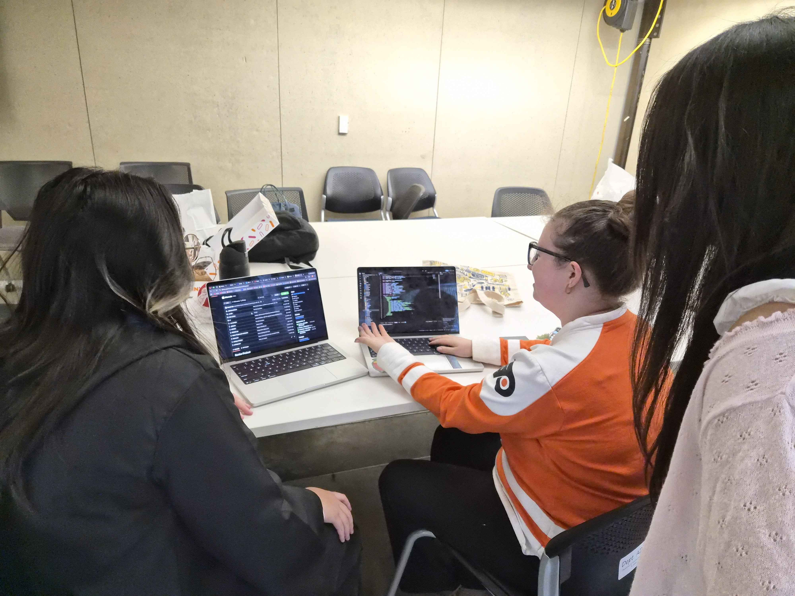
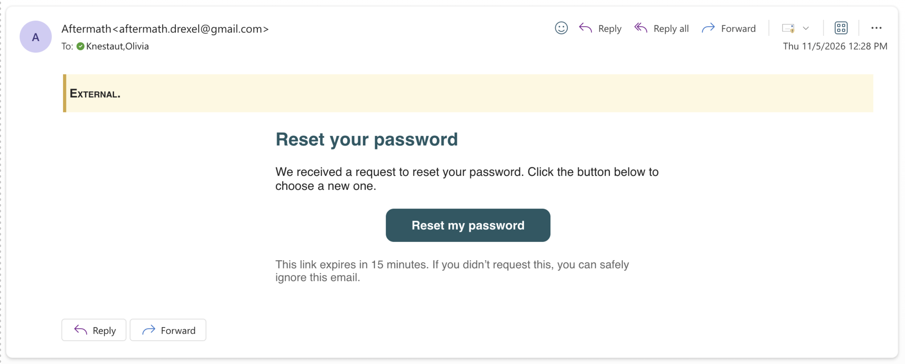
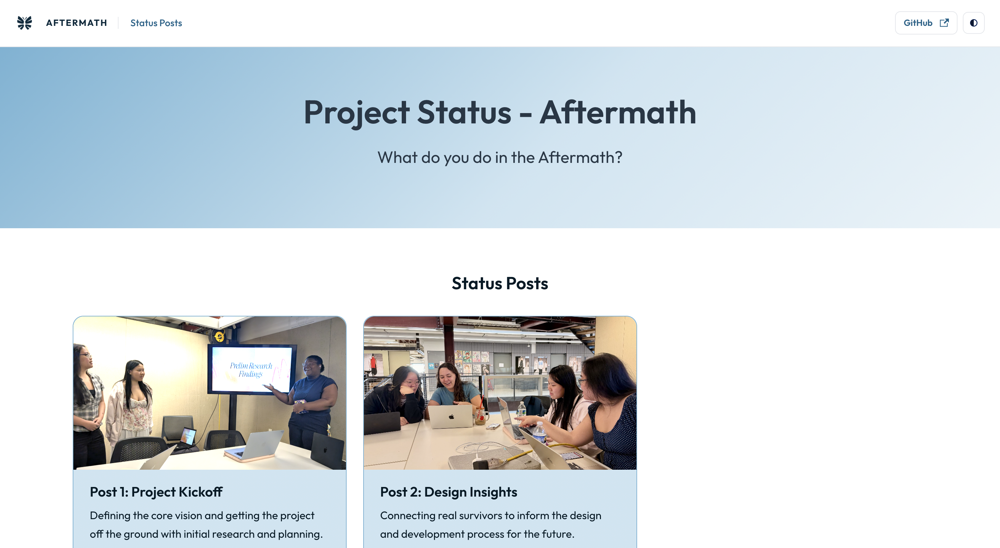
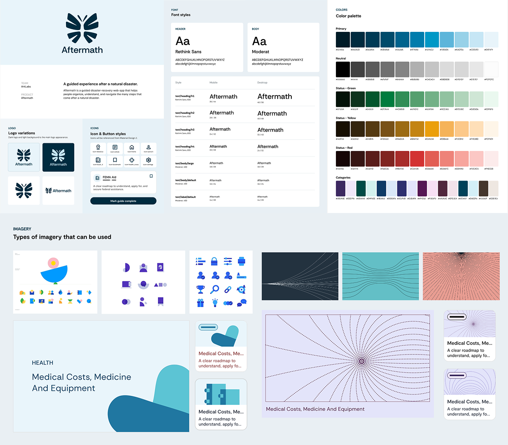
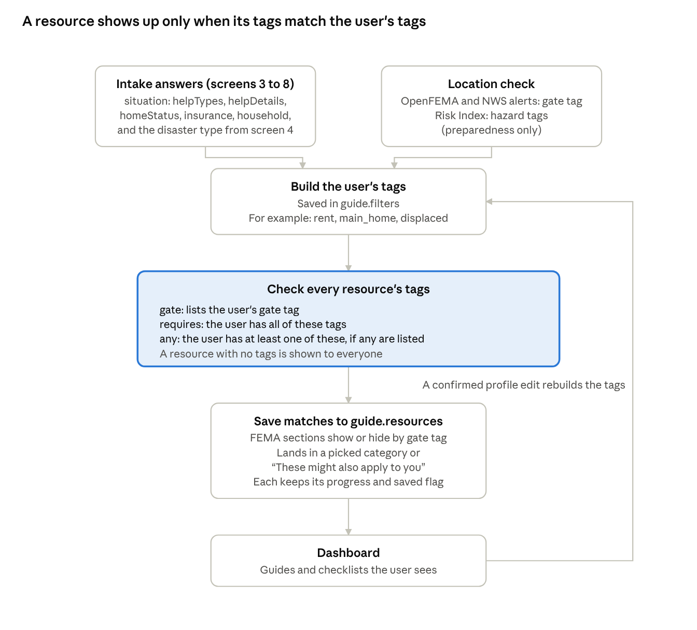
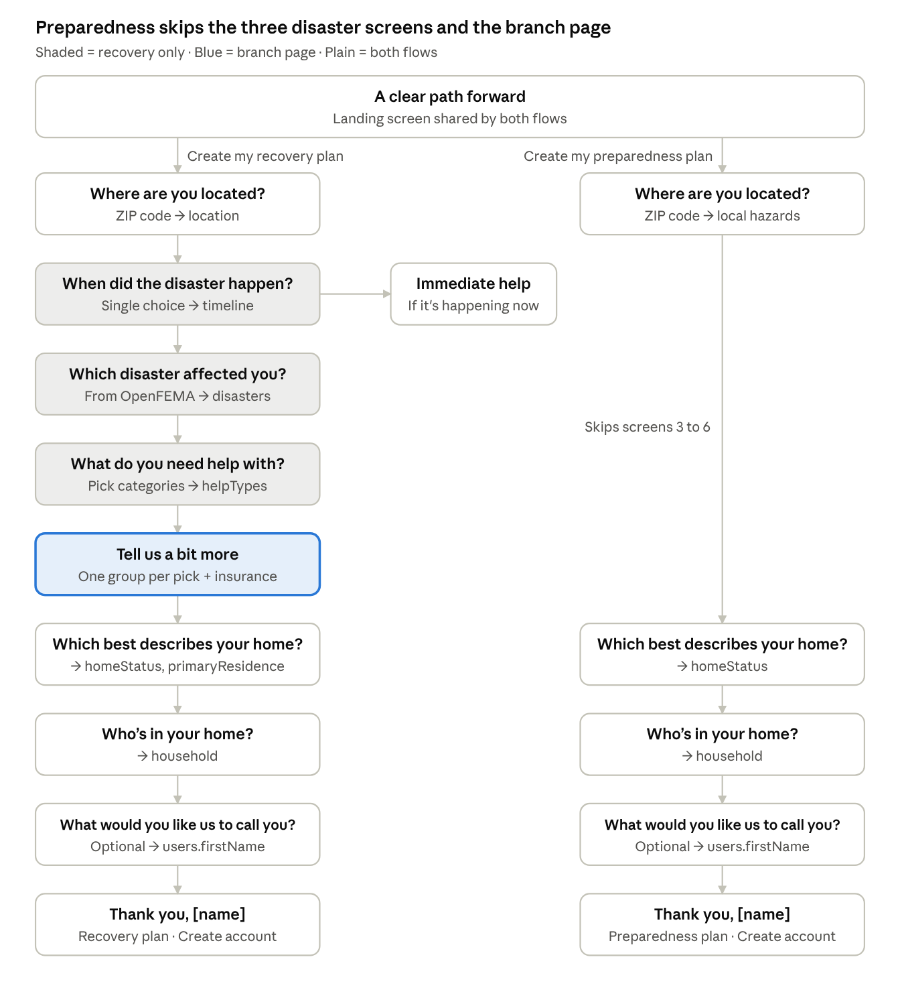

# Post 3: Gearing up for Dev Team 

 

## Completed Tasks 

### Connect Gmail SMTP to reset password flow 

**Olivia —  2 hrs** 

- **Due Date** 11/4/2026 
- **Description:** Look into and implement Email SMTP for password recovery and log in purposes. 
- **Deliverable:** [Aftermath Forgot Password Branch] (https://github.com/ArkLab-SeniorProject/Aftermath/pull/57) 

**Takeaways** 

- SMTP is connected to a free Gmail account  
- Did not need something like SendGrid since we are not doing newsletters or other promotional emails 

### API Connections 

**Tiff — 8 hrs** 

-**Due Date** 11/4/2026 
- **Description:** Connected all APIs (OpenFEMA, Socrata, NWS, Census Geocoder) to the data-access backend as separate TypeScript services. Each one was tested from the terminal. 
- **Deliverable:** [API Progress Git Commits](https://github.com/ArkLab-SeniorProject/Aftermath/pull/58/commits) 

**Takeaways** 

- Census Geocoder cannot look up a ZIP code by itself, so we need to download their ZCTA file which lists every ZIP code with a center point (latitude/longitude) and upload this file onto Mongo or as a JSON. 
- Socrata is not a Nationwide API, as some cities do not use Socrata at all. A discovery script was built to find which cities publish datasets. 
- Public APIs can be slow; one public Overpass server was overloaded, so automatic switching to a backup server was added. 
 

### Page Structure and Connections for First Critical Flow 

**Olivia — 4 hrs ** 

- **Due Date** 11/9/2026 
- **Description:** Based on the site map and wire frames begin the dev page set up and flow on the front end side. 
- **Deliverable:** [Page Structure Pull Request] (https://github.com/ArkLab-SeniorProject/Aftermath/pull/57) 

**Takeaways** 

- All screens through the recovery quiz flow connect, even if the data is fake. 
- Pages exist but styling is temporary while style guide is finalized. 
- Next step for this flow is the API tie ins to actually populate a guide  

### Low-Fidelity User Testing 

**Amy, Maple, Mack — 5 hrs** 

-**Due Date** 11/06/2026 
- **Description:** Evaluating whether participants can understand and move through Aftermath’s core flows (minimum of 3 users to test with). 
- **Deliverable:** [Page Structure Pull Request] (https://github.com/ArkLab-SeniorProject/Aftermath/pull/57) 

**Takeaways** 

-  

### Low-Fidelity Testing Report 

**Amy, Mack — 4 hrs ** 

-**Due Date** 11/08/2026 
- **Description:** Evaluating whether participants can understand and move through Aftermath’s core flows (minimum of 3 users to test with). 
- **Deliverable:** [Lo-Fi Testing Report] (https://drexel0.sharepoint.com/:w:/r/sites/27SrProj_Aftermath_16fd2c/Shared%20Documents/Design%20and%20Research%20Hub/research-hub/lofi-research/research-lofi-usability-testing-summary-report.docx?d=wa5c13f533f964f22b8abfdbee291e57f&csf=1&web=1&e=2ukRpx) 

**Takeaways** 

- Determine the timeline at which the user is meant to utilize Aftermath 
- Deadline section is not accurate to how recovery after a natural disaster is like; will be removed as FEMA is the only deadline  

### Update Status Post Site CSS 

**Hannah — 2hrs** 

-**Due Date** 11/10/2026 
- **Description:** Based on the branding and style guide, updated the status post site as well as the github and team's logos to match the Aftermath Brand.  
- **Deliverable:** [Updated Site](https://arklab-seniorproject.github.io/ArkLab-Status/) 

**Takeaways** 

- Once core imagery is decided between blocky elements and line motifs, update the background gradient and finalize update 
- Figured out the docusaurus overrides and details in the code 
 

 

### Brand Identity and Style Guide 

**Amy, Mack, Maple — 10 hrs** 

-**Due Date** 11/11/2026 
- **Description:** Develop Aftermath’s brand identity, color ways, imagery, and typography. 
- **Deliverable:** [Aftermath Brand Identity](https://www.figma.com/design/r9vE99soUQcvwyIalZ0bEq/SR-Aftermath?node-id=2141-4344&t=sHpoxrRGY5XJbEdT-1) 

**Takeaways** 

- Established a brand identity that represents Aftermath 
- Created two different imagery routes Aftermath can go down 
- Need to test with users in Mid-fi to narrow down imagery direction 
 

 

### API Connections to Questions 

**Tiff — 6 hrs** 

-**Due Date** 11/11/2026 
- **Description:** Connect APIs onto the recovery quiz flow for disaster and location-based questions. 
- **Deliverable:** [API Progress Commits](https://github.com/ArkLab-SeniorProject/Aftermath/pull/58/commits) 

**Takeaways** 

- Guests can save without an account. Each guest gets a private token, and the database stores only a scrambled (hashed) copy of it. If the guest signs up or logs in later, their answers move to their new account 
- Entering only a ZIP code will locate a county. Users that enter an address will have a more precise location. 

### Content Development Documentation 

**Mack — 10 hrs ** 

-**Due Date** 11/13/2026 
- **Description:**  Developing the framework for content development within Aftermath, including the database of guides and checklists and the content and filtering system for dev/design handoff.  
- **Deliverable:** [Content Tracker](https://drexel0.sharepoint.com/:x:/r/sites/27SrProj_Aftermath_16fd2c/Shared%20Documents/Content%20and%20Copy%20Hub/content-tracker.xlsx?d=w3ec13f0a1dcd411291a167459ad7a322&csf=1&web=1&e=Xo1ZIi), [Content Filtering System](https://drexel0.sharepoint.com/:w:/r/sites/27SrProj_Aftermath_16fd2c/Shared%20Documents/Content%20and%20Copy%20Hub/content-sources-filter-system.docx?d=w59045b4a0fcb435288ac65d4e71cd423&csf=1&web=1&e=VgareR) 

**Takeaways** 

- There were lots of unanswered questions about user and state changes that we had to go through as a team.  
- It hasn't significantly affected our design but it has shifted it enough that it is maybe something we should have started earlier! However, we now have a system set up as well as a list of guides to work off for development of the content of the guides and the system, surrounding it.  
 
 

---

## Open Tasks 

### Task Name 

**Name or Team** 

-**Due Date** 00/00/0000 
- **Description:** Details 

### Develop Example Guide + Checklist 

**Amy, Maple, Mack** 

-**Due Date** 11/14/2027 
- **Description:** Develop and example guide and checklist to be utilized within mid-fidelity testing. 

### Database Structure Updates 

**Olivia — 6 hrs** 

-**Due Date** 11/16/2026 
- **Description:** Update the Mongo DB Structure based on recovery and preparedness content needs and update GraphQL Structure to match. 

### Mid-Fidelity Prototype 

**Amy, Maple** 

-**Due Date** 11/18/2027 
- **Description:** Complete the mid-fidelity prototypes for all three user flows. 

### Mid-Fidelity Question Development 

**Amy, Maple, Mack** 

-**Due Date** 11/18/2027 
- **Description:** Establish how mid-fidelity usability testing will be done and develop the questions that will be asked. 

### Start Updating the Instagram Account 

**Hannah** 

-**Due Date** 12/09/2026 
- **Description:** Make a meet the team post, and parse through other post ideas that could work well on a team Instagram. 

### Set up the Figma MCP with Claude Code 

**Hannah and Liv** 

-**Due Date** 12/09/2026 
- **Description:** Set up the Claude Code to match with a Figma MCP so that when coding and using Claude code, it has all of the context of our designs. This may require us to stop mooching off of Macks Claude Premium and get a Group Claude for the project.  

### Look into potential areas for Micro Interactions 

**Hannah** 

-**Due Date** 01/04/2027 
- **Description:** Start parsing through the core design flows and pick out where interactions may improve users experience. 

---

## New Tasks 

### Create DESIGN.md Based on Style Guide and Implement 

**Olivia, Hannah** 

-**Due Date** 11/19/2026 
- **Description:** Create a detailed DESIGN.md document based on the styles in Figma and use it to create a theme for Material Design Components in the code base. 

### Create and Connect Screens for Preparedness Flow 

**Olivia — 4 hrs** 

-**Due Date** 11/24/2026 
- **Description:** Create the preparedness quiz, similar to the recovery quiz and ensure the values are also saved and populated when logged in. 

### Create Q1 Final Presentation 

**All Hands** 

-**Due Date** 12/09/2026 
- **Description:** Create and practice for the final presentation of progress after one quarter of work 

### Mid-Fidelity Usability Test 

**Amy, Maple, Mack** 

-**Due Date** 11/25/2027 
- **Description:** Further validating whether participants can understand and move through Aftermath’s core flows and branding (minimum of 3 users to test with). 

---

## Meetings 

### Thursday, Oct. 29 [11:49am-1:00pm] 

All Hands(All Members) 

#### Meeting Agenda 

- Review Flows for the Testing Sessions 
- Start with create recovery plan 
- Who lives with you question: Just me may be confusing, but it is a multi-select so it may be confusing. If you select just me, could we make everything else not selectable, but what if you have pets? We are removing pets there aren’t resources directly related to it 
- Dashboard flow 
- Upcoming deadlines doesn’t really work with how applications work. The only deadlines required are the 30 days after FEMA. Likes the pronunciation of the FEMA application 
- Customizable deadlines so users can set their own deadlines and customize it themselves 
- Keep a track record of what you submitted and when for legal purposes 
- Even if you aren’t eligible for FEMA, you need to apply and get denied in order to apply and be eligible for other grants. 
    - most people get denied FEMA but that denial is a message of what you can do next 
    - even if you are approved you need to be denied first anyways 
    - we plan to explain that process on the application- if you get denied keep going because you will be denied first anyways 
- Instagram
    - Journal/Diary of our process and journey with the project 
    - Team Introduction Post 
    - Project pitch in Instagram format 
    - Status Post Updates / Monthly updates 
    -  More in progress photos of us doing work 
    - LinkedIn posts for the mid year 
    - Ark Labs Wrapped (like a Spotify wrapped for hours worked, people interviewed etc.) 
    - bug of the week 
    - Mock awards: “Most unnecessary CSS updates” 
    - Things we’ve debated way too long 
    - Our project in browser tabs 
        - showing the different apps, we use for our project 
    - Prepare at Home / Features we have in app 
    - Discuss branding and style guide application + accent colors 

### Monday, Nov. 02 [2:00-3:00pm] 

All Hands (All Members) 

#### Meeting Agenda 

- Review Kanban Board and Progress 
- Extend the task of setting up the development page 
- Content development is an ongoing struggle 
- Pushing Style Guide and Brand identity due date to this Friday 
    - in order to incorporate the testing and additional surveys 
- Review final presentation timing and order 

### Monday, November. 11 [1:00pm-3:00pm] 

Design and Research Team (Amy, Maple, and Hannah) 

#### Meeting Agenda 

- Reviewed the finalized style guide and branding 
    - Debate between the line motif or the blocky motif, decided to put it up to the users for a vote of which motif matches the application better 
- Set up the testing session for Jervo and ran it 

### Thursday, Nov. 05 [10:00am-1:00pm] 

All Hands (All Members) 

#### Meeting Agenda 

- Review adjusted timeline based on new final presentation date 
    - presentation is like a more official overarching status post  
- Review logo and branding 
- Review sections and content  
- review categories, they are based on FEMA  
- review Apis and filter system and how it will functionally work cross design and development team 
    - it fetches the Api when the user inputs the situation and then once a day when they log in to prevent outdated information on the site 
    - if they change answers do we tell them in a pop up which guides are removed or added 
    - as a notification type alert 
    - what if they start a guide, should they be able to undo? 
    - maybe we keep the guides that are saved or started so that they remain, but there needs to be a clear saved guide section 
- In the code change database “guide” and “resources” to “plan” and “guides” in order to match design changes 
- Should the user be aware there are other categories they don’t have: no 
- Dev team worked on the email verification and user flow 
- Did we change the preparedness plans to just be checklists? 
    - yes, for resources its all guides but for preparedness is all checklists  
    - they all live in the resources database: the database just has guides and checklists, not all guides have checklists, some guides have checklists, some guides don't have checklist, and some resources are just checklists 
- To do: 
    - Olivia: In the database change guide to be named plan, and keep resources to contain both resources and guide; Add additional db fields and ensure all pages exist for the critical flow 
        - need to add a database check, for is this resources a checklist, if it is a guide does it contain a checklists 
    - Amy and Maple: Update and finalize style/branding guide, 
    - Hannah: Update the CSS for the status post site and the logos across systems, send liv the round version of the logo 
        - make sure any live site links go to the new domain that is in the wiki 
    - Tiff: Work on connecting APIs to recovery quiz flow  
    - Research: Finalize low fi testing and doc and research write up  